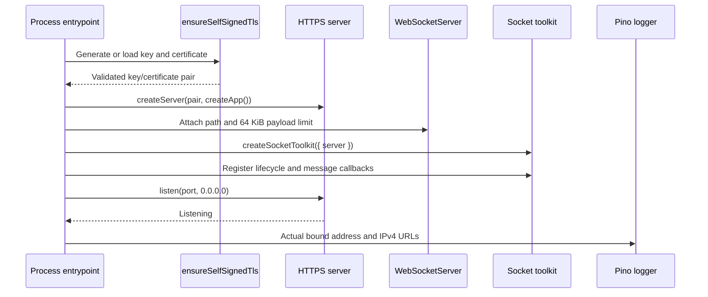

# Application and Server

**Documentation version:** 1.0.0  
**Status:** Implemented for local development  
**Last updated:** 2026-11-14

[Documentation index](../../../../README.md)

The application composition root builds Express. The server composition root prepares TLS, creates the
shared HTTPS/WebSocket listener, wires socket events, logs IPv4 URLs, and owns shutdown.
The application module currently contains the self-signed TLS helper and its integration tests.

## Table of contents

- [Module structure](#module-structure)
- [HTTP and WebSocket endpoints](#http-and-websocket-endpoints)
- [Startup sequence](#startup-sequence)
- [Self-signed TLS](#self-signed-tls)
- [Programmatic usage and shutdown](#programmatic-usage-and-shutdown)
- [Logging and failure behavior](#logging-and-failure-behavior)
- [Tests and verification](#tests-and-verification)

## Module structure

| File                                                                                                | Responsibility                                                                             |
| --------------------------------------------------------------------------------------------------- | ------------------------------------------------------------------------------------------ |
| [`src/app.ts`](../../../app.ts)                                                                     | Export `clientPath` and build Express with the page route and 404 fallback.                |
| [`src/server.ts`](../../../server.ts)                                                               | Export `startServer()`; own listener configuration, socket policy, IPv4 logs, and cleanup. |
| [`self-signed.tls.ts`](../infra/configs/self-signed.tls.ts)                                         | Export `SELF_SIGNED_TLS_DIRECTORY` and `ensureSelfSignedTls()`; generate or load the pair. |
| [`message-board.html`](../../../../message-board.html)                                              | Browser UI served by Express.                                                              |
| [TLS integration tests](../tests/integration/self-signed.tls.integration.test.ts)                   | Certificate generation, reuse, permissions, and preservation on invalid input.             |
| [Server integration tests](../../socket/tests/integration/message-board.server.integration.test.ts) | Real HTTPS routes, WSS broadcasts, message limits, and listener lifecycle.                 |

`createApp()` does not listen or generate certificates. `startServer()` composes the
[socket toolkit](../../socket/documentation/README.md) around its own `WebSocketServer`.

## HTTP and WebSocket endpoints

| Protocol / request                       | Path                 | Result                                                   |
| ---------------------------------------- | -------------------- | -------------------------------------------------------- |
| HTTPS GET                                | `/api/message-board` | Serve the HTML interface with `Cache-Control: no-store`. |
| WSS upgrade                              | `/api/message-board` | Open a native WebSocket on the same listener.            |
| Other HTTP paths and unsupported methods | Any                  | `404` with the text `404 not found`.                     |
| WSS upgrade on another path              | Any other path       | Reject the upgrade.                                      |

The `/api/message-board` HTTP response is HTML. Messages are plain text WebSocket frames;
there is no HTTP POST message API. Express disables the `X-Powered-By` header.

The listener binds all IPv4 interfaces using `0.0.0.0`. It uses the supplied `port`, then the `PORT`
environment variable, then `8887`. Invalid ports fail before listener creation.

## Startup sequence



Incoming messages must be text with at least one non-whitespace character. Accepted text is broadcast
unchanged, including line breaks and surrounding whitespace. Blank or binary messages produce an
operational error log and are not broadcast. They do not deliberately close the connection.
The WebSocket transport closes oversized incoming messages with code `1009`.

## Self-signed TLS

`ensureSelfSignedTls(directory?)` returns `{ key: Buffer, cert: Buffer }`.
Its default directory resolves to repository-root `tls/` in both source and compiled layouts.

| Existing files                          | Behavior                                |
| --------------------------------------- | --------------------------------------- |
| Neither file exists                     | Generate both files with OpenSSL.       |
| Both files exist and form a valid pair  | Reuse them without replacement.         |
| Only one exists                         | Reject startup and preserve it.         |
| Malformed material or a mismatched pair | Reject startup and preserve both files. |

Generation creates an RSA-2048, SHA-256 self-signed server certificate valid for 365 days.
Its names include `localhost`, `127.0.0.1`, and the current non-internal IPv4 interface addresses.
It is marked for server authentication and is not a CA certificate.

The helper stages generation before publishing the files, creates a new TLS directory with mode `0700`,
and sets the generated private key to `0600`. Existing directories and keys retain their existing
permissions. The pair is validated with Node's `createSecureContext()` before use.
Local TLS material is excluded by the repository's ignore rules.

Existing certificates are not automatically renewed or regenerated when the LAN IP changes.
To renew or add a new address, stop the server, move **both** files together to a secure backup outside
the repository, and start the server again. It will generate a new pair for the current addresses.
Clients that trusted the old certificate must explicitly trust the replacement.

A self-signed certificate encrypts the connection; trusting the server certificate and controlling
who may connect remain separate concerns. Current startup does not add authentication or client certificates.

## Programmatic usage and shutdown

From a TypeScript entrypoint under `src/`:

```ts
import { startServer } from './server.js';

const instance = await startServer({ port: 8887 });

// Application callers can use the already-composed socket service.
await instance.socketToolkit.service.broadcast('Server announcement');

// Call when the owning process is ready to shut down.
await instance.stop();
```

The returned `ServerInstance` exposes `httpServer`, `wsServer`, `socketToolkit`, and `stop()`.
Despite its field name, `httpServer` is a Node **HTTPS** server.
Importing `server.ts` does not start a listener; direct execution starts it and registers
`SIGINT` and `SIGTERM` handlers.

`stop()` terminates active WebSockets, closes both servers, and returns a shared promise on repeated
calls. Termination ends browser connections and clears their UI messages; shutdown does not drain
application messages or wait for recipient acknowledgements.
If listening fails, the new WebSocket server is closed before the error propagates.

## Logging and failure behavior

Pino logs the listener address, every non-internal IPv4 interface and its HTTPS URL, connection IDs,
disconnect codes, and operational errors. Virtual interfaces can appear alongside Wi-Fi or Ethernet.
Normal message bodies are not written to the application log.

A failure to enumerate interface addresses produces a warning after the listener starts.
TLS or listener failures reject `startServer()`. The directly executed entrypoint logs startup and
shutdown failures and sets a failing process exit code.

## Tests and verification

Run the TLS and server suites from the repository root:

```bash
npm run test:integration -- src/modules/application/tests/integration src/modules/socket/tests/integration/message-board.server.integration.test.ts
```

The linked TLS tests use temporary directories and real OpenSSL. They cover the certificate's names,
self-signature, reuse, Unix permissions, incomplete files, malformed files, and key/certificate mismatch.
Unix permission assertions are skipped on Windows.

The server tests use real HTTPS/WSS connections and explicitly trust the generated public certificate.
They cover HTML and 404 responses, rejection without explicit certificate trust, broadcasts, fresh
connections without history, invalid messages, exact 64 KiB ASCII and Unicode payloads, oversized frames,
wrong upgrade paths, invalid ports, repeated shutdown, and cleanup after a port conflict.

These suites do not establish reachability from another physical device or browser-specific clipboard behavior.
