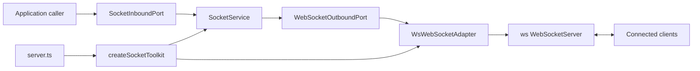
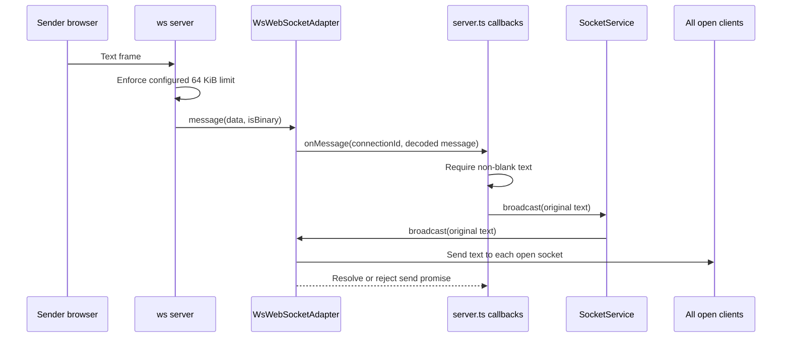

# Socket Module

**Documentation version:** 1.0.0  
**Status:** Implemented with native WebSockets  
**Last updated:** 2026-11-14

[Documentation index](../../../../README.md)

The socket module exposes event registration and broadcast operations through application ports.
Its ws adapter translates native WebSocket events and writes to connected clients.
The [server composition root](../../../server.ts) owns the listener, URL path, message policy, and shutdown.

## Table of contents

- [Module structure](#module-structure)
- [Architecture](#architecture)
- [Ports and APIs](#ports-and-apis)
- [Dependency injection and event registration](#dependency-injection-and-event-registration)
- [Connection tracking and errors](#connection-tracking-and-errors)
- [Message sequence](#message-sequence)
- [Connect from Node.js](#connect-from-nodejs)
- [Tests and verification](#tests-and-verification)
- [Operational boundaries](#operational-boundaries)

## Module structure

| File                                                                                       | Responsibility                                                                  |
| ------------------------------------------------------------------------------------------ | ------------------------------------------------------------------------------- |
| [`socket.inbound.port.ts`](../app/ports/inbound/socket.inbound.port.ts)                    | Application-facing `SocketInboundPort`.                                         |
| [`websocket.outbound.port.ts`](../app/ports/outbound/websocket.outbound.port.ts)           | Transport-facing `WebSocketOutboundPort` and `WebSocketEventHandlers`.          |
| [`socket.service.ts`](../app/services/socket.service.ts)                                   | Implement the inbound port using the injected outbound port.                    |
| [`ws.websocket.adapter.ts`](../adapters/outbound/ws/ws.websocket.adapter.ts)               | Register native events, decode payloads, report callback errors, and broadcast. |
| [`socket.di.ts`](../infra/di/socket.di.ts)                                                 | Compose one adapter and service over the supplied server.                       |
| [Adapter integration tests](../tests/integration/ws.websocket.adapter.integration.test.ts) | Exercise the adapter against real sockets.                                      |
| [Server integration tests](../tests/integration/message-board.server.integration.test.ts)  | Exercise the configured HTTPS/WSS app through the toolkit.                      |

## Architecture



Application callers use the inbound port. The service receives its transport as
`SocketServiceDeps.socket`. The adapter depends on the concrete ws server.
The service delegates registration and broadcasting; message validation currently lives in `server.ts`.

## Ports and APIs

Both ports expose the following methods:

| Method                                      | Contract                                                                                   |
| ------------------------------------------- | ------------------------------------------------------------------------------------------ |
| `registerEvents(handlers): void`            | Register lifecycle/message callbacks once, including for already-connected clients.        |
| `broadcast(message: string): Promise<void>` | Send text to every open client, including its sender when invoked for an incoming message. |

The event-handler contract is:

| Callback       | Arguments                                        | Behavior                                                                          |
| -------------- | ------------------------------------------------ | --------------------------------------------------------------------------------- |
| `onConnection` | `connectionId: string`                           | A UUID identifies this socket connection.                                         |
| `onMessage`    | `connectionId`, `message: string \| Uint8Array`  | Text is decoded as UTF-8; binary frames remain bytes.                             |
| `onClose`      | `connectionId`, `code: number`, `reason: string` | The reason is decoded as UTF-8.                                                   |
| `onError`      | `error: unknown`, optional `connectionId`        | Receives transport and callback failures; must be synchronous and must not throw. |

The first three callbacks may return `void` or `Promise<void>`.
A server-level error has no connection ID. A callback or client transport error includes its connection ID.

`broadcast()` resolves when the selected send callbacks complete, and rejects if a send reports an error.
It resolves immediately when no open clients exist. Completion is not proof that recipients read or
processed the message.

## Dependency injection and event registration

`createSocketToolkit({ server })` returns `{ adapter, service }`.
It does not open a listener, register application callbacks, or close the supplied server.

The following composition fragment assumes an owned `wsServer` and Pino `logger`, as in `src/server.ts`:

```ts
import { createSocketToolkit } from './modules/socket/infra/di/socket.di.js';

const socketToolkit = createSocketToolkit({ server: wsServer });

socketToolkit.service.registerEvents({
  onConnection(connectionId) {
    logger.info({ connectionId }, 'WebSocket connected');
  },
  onMessage(_connectionId, message) {
    if (typeof message !== 'string' || message.trim().length === 0) {
      throw new Error('Message must be non-empty text.');
    }
    return socketToolkit.service.broadcast(message);
  },
  onClose(connectionId, code) {
    logger.info({ connectionId, code }, 'WebSocket disconnected');
  },
  onError(error, connectionId) {
    logger.error({ err: error, connectionId }, 'WebSocket error');
  },
});
```

The existing `startServer()` already performs this registration. A second registration on the same
adapter throws `WebSocket event handlers are already registered.` before adding more listeners.
Keep one toolkit for each supplied server to avoid duplicate handling.

## Connection tracking and errors

The ws server's native `server.clients` set tracks live connections. The adapter iterates that set;
it does not keep a second connection map. Disconnected clients are removed by ws.
Each newly connected socket receives its own UUID, so reconnecting creates a new connection identity.
Clients connected before registration receive their handlers and `onConnection` callback during registration.

The private `dispatch()` helper invokes an application callback and routes synchronous throws or rejected
promises to `onError`. Event listeners do not await each callback before processing the next event;
there is no per-client application queue or processing-order guarantee for asynchronous handlers.

For broadcasting, sockets not in the `OPEN` state are skipped. A send failure is reported through the
returned promise; sends to other selected clients may already have succeeded.

## Message sequence



The configured server accepts up to **65,536 UTF-8 bytes**, not 65,536 arbitrary characters.
For example, ASCII `x` uses one byte and `👋` uses four bytes. Oversized incoming messages close with
code `1009`. This transport limit is configured by the server; the reusable adapter does not impose
its own size or blank-message policy.

## Connect from Node.js

An ESM client run from the repository root can explicitly trust the generated public certificate:

```js
import { readFile } from 'node:fs/promises';

import WebSocket from 'ws';

const socket = new WebSocket('wss://localhost:8887/api/message-board', {
  ca: await readFile('tls/server.crt'),
});

socket.on('open', () => socket.send('Hello from Node.js 👋'));
socket.on('message', (data) => {
  console.log(data.toString('utf8'));
  socket.close();
});
socket.on('error', console.error);
```

Run the server first and use its actual port. A remote client needs the public certificate through a
trusted channel; it never needs the private key.
For the built-in browser client, see the [UI guide](../../../../documentation/client/README.md).

## Tests and verification

From the repository root:

```bash
npm run test:integration -- src/modules/socket/tests/integration
```

The adapter suite uses real ws servers and clients. It covers broadcast fan-out, no connected clients,
closing sockets, empty transport-level text, connection IDs and tracking, text/binary decoding,
close details, existing clients, duplicate registration, protocol errors, callback failures, and server errors.

The server suite covers the service/toolkit wiring, HTTPS/WSS path, application validation, exact-limit
ASCII and Unicode messages, over-limit rejection, lack of message replay, and shutdown.
See the [application guide](../../application/documentation/README.md#tests-and-verification)
for those contracts and certificate prerequisites.

## Operational boundaries

Everyone connected to the configured server participates in the same broadcast.
There are no accounts, rooms, per-user delivery, saved messages, replay, or delivery acknowledgements.
No heartbeat, rate limit, or slow-client queue limit is implemented.
A message-size bound limits each incoming message, not total session memory or message frequency.
